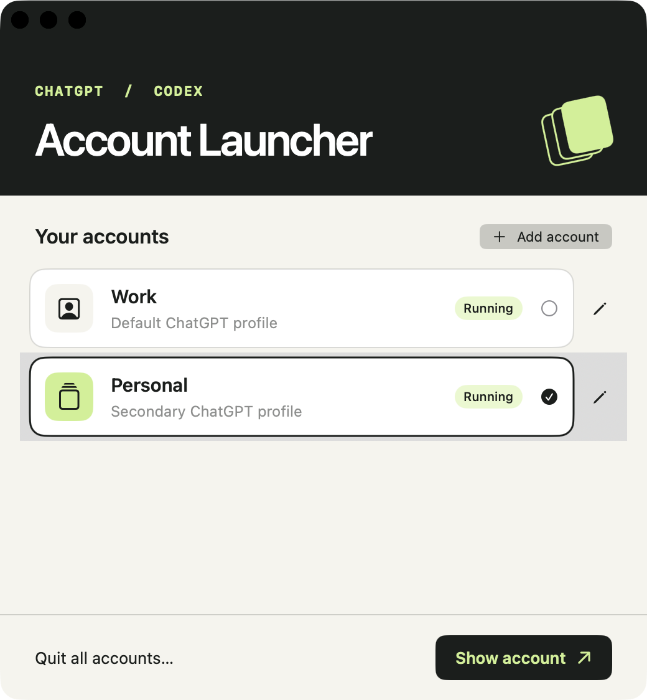

# Codex Account Launcher

A native macOS picker for opening and switching between Codex desktop accounts. Use a separate profile for each sign-in and give it a name you recognize, such as Work or Personal.



## Build and install

You'll need macOS 13 or later, Apple's Xcode Command Line Tools, and the desktop app with bundle identifier `com.openai.codex`. The launcher supports Apple silicon and Intel Macs.

```sh
git clone https://github.com/marcosmro/codex-account-launcher.git
cd codex-account-launcher
./build.sh
open dist/Multi-AI-Launcher-1.0.4.pkg
```

Follow the Installer prompts, then open **ChatGPT Account Launcher** from Applications. The launcher finds the desktop app automatically or asks you to locate it.

## Using the picker

Select a profile with the arrow keys and press Return, or double-click its row. **Open account** starts a closed profile. **Show account** brings a running profile to the front. The launcher remembers the last profile you successfully opened.

Choose **Add account** (⌘N) to create a profile, then sign in once. Use the pencil beside a profile to change its display name.

To return to the picker, click its Dock icon. Control-click the icon and choose **Options → Keep in Dock** to keep it handy. **Quit all accounts…** asks every running instance to quit after you confirm, including instances opened outside the launcher.

## Account storage

| Account | Codex home | App data |
| --- | --- | --- |
| Main account | Desktop app default | Desktop app default |
| Second account | `~/.codex-second` | `~/Library/Application Support/ChatGPT-Second` |
| Named account | `<profile>/Codex` | `<profile>/AppData` |

Named profiles live in `~/Library/Application Support/ChatGPT Account Launcher/Profiles/<name>`. The launcher discovers profiles created with the original AppleScript version. New names accept 1–40 ASCII letters, digits, spaces, underscores and hyphens. Names must be unique and cannot start or end with a space.

The launcher focuses the ChatGPT process holding the selected profile’s local Electron instance lock. When that profile is closed, the launcher starts it with explicit Codex and app-data folders. The picker hides after sending the request and returns when you click its Dock icon. Secondary profiles use the desktop app’s internal environment settings and user-data argument. Desktop app updates may change this behavior. Each profile runs with your macOS user’s file access.

To uninstall, move **ChatGPT Account Launcher** from Applications to the Trash. Profile data remains in the locations above.

## Verify the build

After building, run the account storage and discovery tests from the repository directory.

```sh
xcrun swiftc -module-cache-path .build/module-cache src/Accounts.swift tests/AccountsTests.swift -o .build/accounts-tests
.build/accounts-tests
```

The build creates a universal app and an Installer package in `dist/`. The package installs only the app in `/Applications`. The default local build uses an ad hoc app signature and an unsigned installer.

## Public release

Use Developer ID Application and Developer ID Installer certificates and a saved notarytool keychain profile:

```sh
APP_SIGN_IDENTITY='Developer ID Application: YOUR NAME (TEAMID)' \
INSTALLER_SIGN_IDENTITY='Developer ID Installer: YOUR NAME (TEAMID)' \
NOTARY_PROFILE='your-notary-profile' ./build.sh
```

The release build signs the app and package, submits the package to Apple, staples the notarization ticket and checks Gatekeeper acceptance. Distribute the resulting `.pkg`. Before publishing a new version, update the version and build number in `build.sh` and test installing, creating a profile and reopening it on a clean Mac with a supported desktop app.
